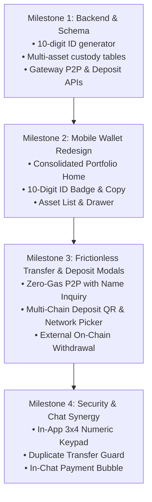

# Masanawa Multi-Currency Wallet, P2P Transfers & Crypto Architecture
## Comprehensive System Specification & Execution Plan

**Document ID:** `MASANAWA-WALLET-CRYPTO-SPEC-20261020`  
**Status:** Approved Architecture & Implementation Plan  
**Target Subsystems:** Wallet Home (`A11`), Send/Receive (`A13`), Deposit & Withdraw (`A12`/`A14`), Cashier Checkout, Ledger & Database Schema.  
**Platform Scope:** Flutter Mobile App (`apps/mobile`), NestJS Gateway (`services/gateway`), PostgreSQL Schema (`packages/commerce/migrations/`, `packages/security/migrations/`).

---

## 1. Executive Architecture Summary

Masanawa combines the **operational speed and frictionless UX of OPay** with the **clean, high-contrast green/white visual clarity of WhatsApp**, extended to support **multi-currency crypto and zero-gas internal transfers**.

### Key Architectural Pillars
1. **10-Digit Masanawa Account Number (User ID Number):**
   - Every user receives a cryptographically generated, unique **10-digit Masanawa Account Number** (e.g., `8012 345 678`) stored in `security.platform_user_profiles`.
   - It is decoupled from the user's phone number for privacy.
   - Serves as the primary identifier for zero-gas P2P transfers.
2. **Multi-Token Custody Ledger:**
   - Supports **MSNW** (primary utility token), **USDT**, **USDC**, **SOL**, **BTC**, and **ETH**.
   - Balance aggregation: Total portfolio value dynamically calculated in base fiat/USD.
3. **Dual-Rail Transfer Engine:**
   - **Internal P2P Rail (Masanawa-to-Masanawa):** Instant, atomic database transfers for **any supported token** with **ZERO gas fees**. Instant recipient name and avatar resolution.
   - **External On-Chain Rail (Crypto Withdrawal):** Network-validated crypto address transfer with dynamic gas fee quotation (TRC-20, BEP-20, Arbitrum, Solana, Polygon).
4. **Frictionless Deposit System:**
   - Token & Network selector with speed/fee hints.
   - Persistent, pre-generated deposit addresses and QR codes.
   - Clear network warnings and 1-tap copy with haptic confirmation.
5. **Cashier Checkout & Mobile Security:**
   - Bottom sheet confirmation showing token debit, fees, and recipient summary.
   - Custom in-app 3x4 numeric keypad preventing OS-level keylogging, paired with biometric fingerprint/face authentication.
   - Duplicate transfer guard (5-minute intercept).
6. **Chat-to-Wallet Synergy:**
   - In-chat instant transfer bubble (`/pay 50 USDT`).
   - Clickable 10-digit IDs in messages that open the pre-filled Send view.

---

## 2. Database Schema & Ledger Design

### 2.1 10-Digit Masanawa Account Number (`security.platform_user_profiles`)
```sql
ALTER TABLE security.platform_user_profiles 
  ADD COLUMN IF NOT EXISTS masanawa_account_number VARCHAR(10) UNIQUE;

CREATE INDEX IF NOT EXISTS idx_platform_user_profiles_account_number 
  ON security.platform_user_profiles(masanawa_account_number);
```

### 2.2 Multi-Asset Custody Accounts (`commerce.multi_asset_custody_accounts`)
Generalizes the custody ledger across any approved asset:
```sql
CREATE TABLE IF NOT EXISTS commerce.multi_asset_custody_accounts (
  tenant_id text NOT NULL,
  user_id text NOT NULL,
  currency text NOT NULL CHECK (currency IN ('MSNW', 'USDT', 'USDC', 'SOL', 'BTC', 'ETH')),
  available_atomic numeric(78,0) NOT NULL DEFAULT 0 CHECK (available_atomic >= 0),
  reserved_atomic numeric(78,0) NOT NULL DEFAULT 0 CHECK (reserved_atomic >= 0),
  updated_at timestamptz NOT NULL DEFAULT statement_timestamp(),
  PRIMARY KEY (tenant_id, user_id, currency),
  FOREIGN KEY (tenant_id, user_id)
    REFERENCES security.platform_user_profiles(tenant_id, user_id)
    ON DELETE RESTRICT
);
```

### 2.3 Internal Zero-Gas P2P Journal (`commerce.p2p_custody_transfers`)
Double-entry balanced transaction journal for internal transfers:
```sql
CREATE TABLE IF NOT EXISTS commerce.p2p_custody_transfers (
  transfer_id uuid PRIMARY KEY,
  tenant_id text NOT NULL,
  sender_user_id text NOT NULL,
  recipient_user_id text NOT NULL,
  currency text NOT NULL,
  amount_atomic numeric(78,0) NOT NULL CHECK (amount_atomic > 0),
  fee_atomic numeric(78,0) NOT NULL DEFAULT 0,
  reference text NOT NULL UNIQUE,
  narration text,
  idempotency_key text NOT NULL,
  created_at timestamptz NOT NULL DEFAULT statement_timestamp(),
  CHECK (sender_user_id <> recipient_user_id)
);
```

### 2.4 User Crypto Deposit Addresses (`commerce.crypto_deposit_addresses`)
```sql
CREATE TABLE IF NOT EXISTS commerce.crypto_deposit_addresses (
  id uuid PRIMARY KEY DEFAULT gen_random_uuid(),
  tenant_id text NOT NULL,
  user_id text NOT NULL,
  currency text NOT NULL,
  network text NOT NULL CHECK (network IN ('TRC20', 'BEP20', 'ARBITRUM', 'SOLANA', 'POLYGON', 'ETHEREUM', 'BITCOIN')),
  public_address text NOT NULL,
  memo_or_tag text,
  is_active boolean NOT NULL DEFAULT true,
  created_at timestamptz NOT NULL DEFAULT statement_timestamp(),
  UNIQUE (tenant_id, user_id, currency, network)
);
```

---

## 3. UI/UX Journey Specifications

### 3.1 Screen A11: Consolidated Wallet Home
- **Balance Card:**
  - Aggregated Total Balance in USD & MSNW (e.g., `$1,450.80 / 14,508 MSNW`).
  - Eye Toggle: Persistent hide/show masking (`••••••`).
  - Masanawa 10-Digit ID badge: `8012 345 678 [ 📋 Copy ]`.
- **4 Action Buttons:**
  - `[ ↗ Send ]` (Zero Gas P2P & External Crypto)
  - `[ ↙ Deposit ]` (On-Chain Crypto Receive)
  - `[ ⇄ Swap ]` (Instant MSNW/USDT conversion)
  - `[ ⚡ Bills ]` (Airtime, Data, Utilities)
- **Asset List ("My Assets"):**
  - Rows for MSNW, USDT, USDC, SOL, BTC, ETH.
  - Tapping an asset opens its dedicated Asset Drawer with send/receive/history for that token.

### 3.2 Screen A13: Dual-Rail Send Flow
- **Segmented Control:** `[ To Masanawa User (Zero Fee) ]` vs. `[ To Crypto Address ]`.
- **P2P Mode:**
  - Input: 10-digit ID or `@handle`.
  - Trigger: As 10 digits are typed, an animated card displays the recipient's avatar, verified name, and handle.
  - Asset Picker: Dropdown selecting from user's available balances (MSNW, USDT, etc.).
  - Duplicate Alert: If identical amount was sent to recipient in past 5 mins, show prompt: *"Duplicate Transfer Detected"*.
- **External Crypto Mode:**
  - Input: Crypto wallet address.
  - Network dropdown with gas fee estimate.
  - Address validator checking syntax before submission.
- **Authorization:** Cashier bottom sheet with in-app 3x4 numeric keypad + Biometrics.

### 3.3 Screen A12: Frictionless Deposit (Receive)
- **Step 1:** Select Token (MSNW, USDT, USDC, SOL, BTC, ETH).
- **Step 2:** Select Network (e.g. For USDT: TRC-20, BEP-20, Arbitrum, Solana).
  - Badges: Speed and gas fee hints for each network.
- **Step 3:** Display high-contrast QR code, full public address, 1-tap copy button with haptic feedback, and network warning alert.

### 3.4 In-Chat Payment Experience
- Integrated directly into conversation threads:
  - Tapping `+` -> "Transfer Money" opens a compact Send modal.
  - Transferring drops an interactive receipt bubble into the chat for both sender and recipient.
  - Any 10-digit number detected in chat messages renders as a clickable link that opens the Send flow.

---

## 4. Phased Implementation Roadmap



| Phase | Core Deliverable | Files Modified / Created |
| :--- | :--- | :--- |
| **Phase 1** | **Backend Schema & Gateway APIs** | `packages/commerce/migrations/`, `services/gateway/src/msn_wallet/`, `services/gateway/src/talk_profiles/` |
| **Phase 2** | **Mobile Wallet Home Redesign** | `apps/mobile/lib/src/finance/msnw_wallet_home.dart`, `apps/mobile/lib/src/screens/wallet/wallet_screen.dart` |
| **Phase 3** | **Zero-Gas P2P & Crypto Deposit UI** | `apps/mobile/lib/src/finance/crypto_wallet_screen.dart`, `apps/mobile/lib/src/finance/wallet_flow_page.dart` |
| **Phase 4** | **In-App Keypad & Chat Integration** | `apps/mobile/lib/src/ui/components/pin_keyboard.dart`, `apps/mobile/lib/src/screens/chat/` |

---

## 5. Execution Commences

We begin immediately with **Phase 1**:
1. Create database migration for `masanawa_account_number` and multi-asset custody subledgers.
2. Implement backend endpoint for 10-digit account lookup (Name Inquiry API: `GET /v1/wallet/lookup?account_number=...`).
3. Implement internal zero-gas P2P transfer route (`POST /v1/wallet/p2p-transfer`).
4. Update Flutter models and wallet screens in `apps/mobile`.
