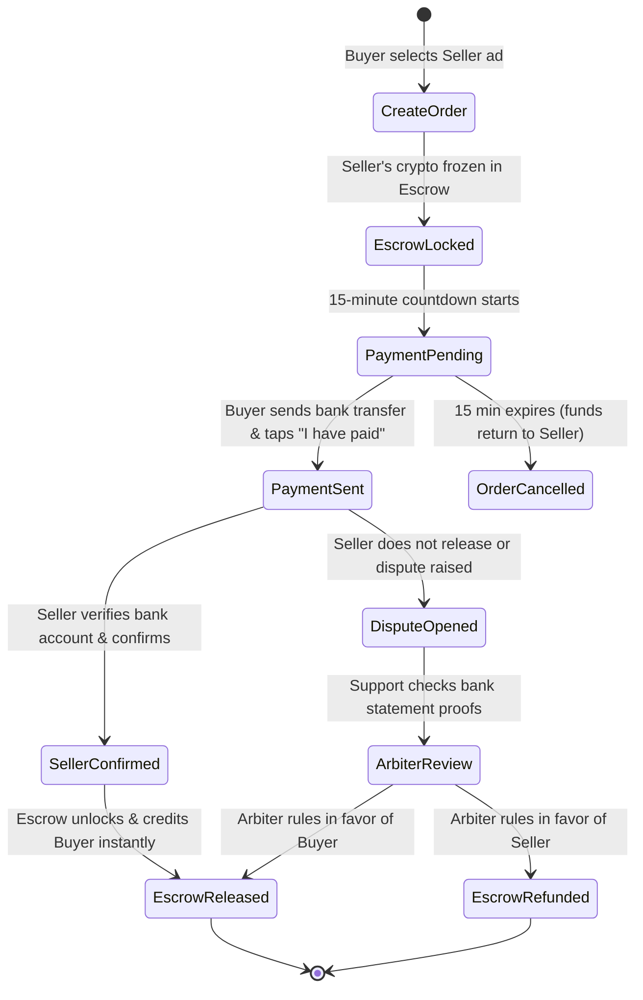

# Telegram Wallet and P2P Architecture Benchmark

**Target Application:** Telegram for Android (v13.1.0, Build 72299, `org.telegram.messenger.web`)  
**Decompiled Artifacts Location:** [`telegram-decompiled/`](file:///c:/Users/Besta/Masanawa/telegram-decompiled)  
**Masanawa Roadmap Alignment:** [Phase 7 — P2P and digital services](file:///c:/Users/Besta/Masanawa/docs/PRODUCT-ROADMAP-20261019.md#phase-7--p2p-and-digital-services-p0p1)

---

## 1. Executive Summary

Telegram's crypto ecosystem is widely regarded as the most seamless chat-integrated financial experience in the world. By reverse-engineering the official `Telegram.apk` (v13.1.0), we examined how Telegram merges **instant chat communication** with **high-security P2P escrow trading**, **multi-asset custody**, and **decentralized Web3 transactions**.

This benchmark extracts Telegram's core design and engineering patterns to implement **Phase 7** of the Masanawa roadmap: an attractive, intuitive P2P marketplace and zero-gas transfers with fraud-proof escrow settlement.

---

## 2. Telegram's Dual-Wallet Architectural Model

Telegram separates crypto finance into two complementary layers:

```
┌────────────────────────────────────────────────────────────────────────┐
│                        TELEGRAM USER INTERFACE                         │
│       In-Chat Transfer  │  Attachment Menu (+ -> Wallet)  │  Settings  │
└───────────────────┬────────────────────────────────┬───────────────────┘
                    │                                │
                    ▼                                ▼
┌──────────────────────────────────────┐  ┌──────────────────────────────┐
│       1. CUSTODIAL P2P WALLET        │  │     2. TON SPACE (WEB3)      │
│          (@wallet WebApp)            │  │  (org.telegram.ui.Wallet)    │
├──────────────────────────────────────┤  ├──────────────────────────────┤
│ - Internal off-chain ledger          │  │ - Non-custodial on-chain     │
│ - Zero gas fee user-to-user transfers│  │ - 24-word seed phrase        │
│ - Instant name/handle resolution     │  │ - WalletEngine2 native code  │
│ - P2P Fiat <-> Crypto Escrow Desk    │  │ - Direct TON/Jetton signing  │
│ - Assets: USDT, TON, BTC, NOT        │  │ - TonConnect dApp bridge     │
└──────────────────────────────────────┘  └──────────────────────────────┘
```

### 2.1 The Custodial P2P Wallet
* **Zero-Gas Internal Transfers:** Sending USDT or TON to another Telegram user requires **0 gas fees** and settles within 100 milliseconds off-chain on internal ledger balances.
* **Direct Handle / Contact Addressing:** Users never type raw blockchain addresses for P2P transfers; they pick a contact or type an `@handle` (matching Masanawa’s 10-digit ID and `@handle` model).
* **In-Chat Message Bubble:** A transfer produces an interactive transaction receipt card inside the 1:1 chat conversation with status, coin icon, and a "View in Wallet" action button.

### 2.2 The Non-Custodial Layer (`WalletEngine2`)
* Found in `classes4.dex` (`Lorg/telegram/ui/Wallet/WalletEngine2;`):
  - `secretPhraseToAddress()`: Converts mnemonics to base64url user-friendly addresses.
  - `emulateSend()`: Dry-runs blockchain transactions to calculate exact network fees before the user authorizes.
  - `nativeSend()`: Signs payloads with the user's private key and broadcasts to validator nodes.

---

## 3. The P2P Escrow Market: Step-by-Step State Machine

Telegram's P2P Market enables users to buy and sell crypto (USDT, TON) using domestic fiat payment methods (Bank Transfer, OPay, Palmpay, Chipper Cash, Revolut, Kuda) without exposing credit cards or relying on centralized fiat processors:



### 3.1 Maker & Taker Ads Listing
* **Ad Attributes:**
  - Order Type: `BUY` or `SELL`.
  - Crypto Asset: `USDT`, `MSNW`, `TON`.
  - Fiat Currency: `NGN`, `USD`, `EUR`, `KES`, `GHS` (formatted via `currencies.json`).
  - Exchange Rate: Fixed or Dynamic market margin (e.g. `1 USDT = 1,650 NGN`).
  - Limits: Minimum and Maximum per trade (e.g. `₦10,000 – ₦250,000`).
  - Accepted Payment Methods: Multi-select tags (e.g. `OPay`, `Kuda`, `Bank Transfer`).
* **Merchant Reputation Metrics:**
  - Completed orders count (e.g. `482 orders`).
  - 30-day completion rate percentage (e.g. `99.4%`).
  - Average payment time (`2.1 minutes`).
  - Average release time (`1.8 minutes`).
  - Verified merchant badge.

### 3.2 Escrow Safety & Anti-Fraud Disciplines
1. **Never Release on Screenshots Alone:** As enforced in `AGENTS.md` Rule 4, payment screenshots or "marked-paid" flags alone **never** release escrow. The seller must verify real bank receipt, or an arbiter must verify cryptographic/bank statement evidence.
2. **Auto-Freeze on Order Open:** The seller cannot move, withdraw, or double-sell crypto once an order is created; the funds are moved to a system escrow account immediately.
3. **Dedicated Order Chat:** A temporary, encrypted trade chat is instantiated for each order, allowing the buyer and seller to communicate payment references without sharing personal phone numbers.
4. **Authoritative 15-Minute Expiry:** If the buyer does not mark "I have paid" within the 15-minute window, the order auto-cancels and funds unfreeze back to the seller.

---

## 4. UI / UX Best Practices Borrowed from Telegram

### 4.1 Gyro-Reactive 3D Wallet Card
* **Assets Reference:** [`telegram-decompiled/assets/wallet_card_2d/`](file:///c:/Users/Besta/Masanawa/telegram-decompiled/assets/wallet_card_2d/)
* **Implementation:** Telegram renders an interactive digital debit card displaying total portfolio balance, cardholder name, and 1-tap QR receive shortcut. As the user tilts their smartphone, custom OpenGL shaders (`groove_across.webp`, `finish_light.webp`) simulate dynamic specular light reflection across the surface.
* **Masanawa Adaptation:** Implement a subtle gyro tilt effect on the Masanawa Wallet Card showing the user's 10-digit ID, total MSNW balance, and Tier verification badge.

### 4.2 In-Chat Transfer Cards
* **Behavior:** When sending money to a contact, Telegram embeds an interactive card inside the chat stream:
  - Token amount with crypto logo.
  - Status indicator (Green checkmark for confirmed).
  - Tap card opens transaction details modal with blockchain explorer / internal journal link.

### 4.3 Multi-Currency Decimal Formatting
* **Assets Reference:** [`telegram-decompiled/assets/currencies.json`](file:///c:/Users/Besta/Masanawa/telegram-decompiled/assets/currencies.json)
* **Rule:** Never hardcode currency decimals or symbols. Telegram maintains a 95-currency table defining exact decimal exponents (`exp: 2` for standard currencies, `exp: 3` for BHD/KWD). Masanawa adapts this table for international fiat conversion rates.

---

## 5. Synthesis: The Three Pillars of Masanawa Mobile

| Capability Pillar | Benchmark Source | Masanawa Implementation |
| :--- | :--- | :--- |
| **Fintech Engine & Keypad** | **OPay** (`opay-decloned/`) | - 10-digit account ID generator (`0113_masanawa_account_number.sql`)<br>- Instant name/avatar inquiry (`GET /v1/wallet/lookup`)<br>- 5-minute duplicate transfer guard<br>- Custom 3x4 numeric keypad with biometric bypass (`pin_keyboard.dart`)<br>- Telco prefix auto-detection for airtime/data |
| **Communication & Design Shell** | **WhatsApp** (`whatsapp-decompiled/`) | - Iconic Green/White WhatsApp Design System (`#25D366`, `#111B21`, `#202C33`)<br>- Asymmetric chat bubble tails & nip geometry<br>- Push-to-talk voice note recorder with lock/cancel gestures<br>- 5-Tab Root Navigation: **Chats · Status · Wallet · Calls · Rooms**<br>- 24-hour status stories with segmented circular rings |
| **P2P Escrow & Web3 Wallet** | **Telegram** (`telegram-decompiled/`) | - Dual-rail internal zero-gas P2P + external crypto transfers<br>- Order-book P2P marketplace for fiat <-> crypto exchanges (Phase 7)<br>- Guaranteed escrow state machine with 15-minute countdowns<br>- Merchant rating badges & dispute arbitration protocol<br>- Interactive in-chat transaction receipt cards |
